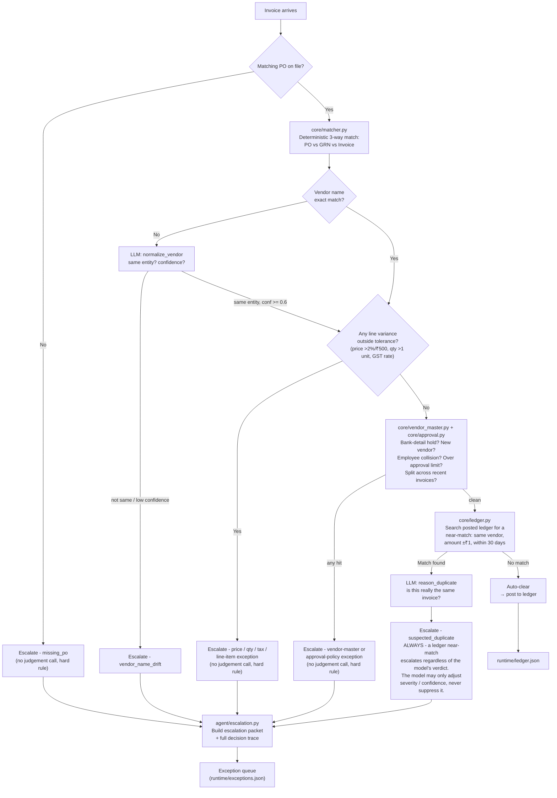
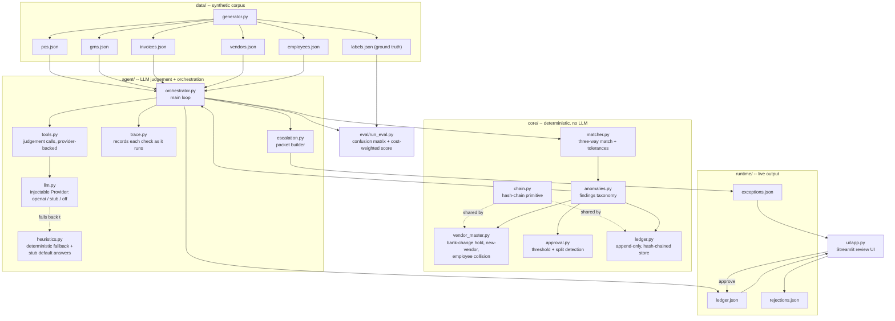

# Ledger Sentinel

An accounts-payable agent, built for **Syndicate by Maximor**, Track 2 -
Autonomous Office of the CFO. The original 11-hour hackathon build did
three-way match: reconcile Purchase Order vs Goods Receipt Note vs Invoice,
auto-clear the clean ones, escalate the rest with a structured packet. This
branch (`v2`) is a substantially larger pass on top of that submission -
tests, a real eval, and three additions that go past three-way match into
where accounts payable actually loses money.

Before a company pays a vendor invoice, an AP clerk has to manually reconcile
three documents: the **Purchase Order** (what we agreed to buy), the **Goods
Receipt Note** (what actually arrived), and the **Invoice** (what the vendor
is billing us). If all three agree, the invoice gets coded and posted to the
ledger. If they don't, it goes into an exception queue for a human to review.

Ledger Sentinel automates the clean path - and treats the exception path as
the actual product. It never guesses on an ambiguous invoice. It escalates
with a structured packet a human can act on in one click, and it shows its
work: every escalation carries an ordered trace of exactly what the agent
checked, in what order, before it decided to hand the invoice to a person.

**The core thesis:** a false-clear (auto-paying an invoice that should have
been escalated) costs far more than a false-escalate (sending a clean invoice
to a human needlessly). The agent is deliberately conservative - tuned to
escalate when uncertain, never to suppress a strong deterministic signal just
because a language model disagrees with it. That thesis used to rest on a
four-line metrics table and no tests. It still holds, but this branch is what
it took to actually check that, and the eval below reports where it's true and
where it currently isn't.

---

## Contents

- [How it works](#how-it-works)
- [The LLM boundary](#the-llm-boundary)
- [The anomaly taxonomy](#the-anomaly-taxonomy)
- [Vendor-master fraud controls](#vendor-master-fraud-controls)
- [Approval and segregation of duties](#approval-and-segregation-of-duties)
- [The tamper-evident ledger](#the-tamper-evident-ledger)
- [Architecture](#architecture)
- [The escalation packet](#the-escalation-packet)
- [Review UI](#review-ui)
- [Design decisions worth knowing about](#design-decisions-worth-knowing-about)
- [Testing](#testing)
- [Running it](#running-it)
- [The eval](#the-eval)
- [Known limitations](#known-limitations)

See also [`EVAL_METHODOLOGY.md`](EVAL_METHODOLOGY.md) for the eval's full
derivation - dataset reproducibility proof, the false-clear rate's stability
across 8 seeds (not just the one in the table below), the structural-vs-LLM
decision boundary made testable, and the adversarial testing done against the
duplicate-veto invariant.

---

## How it works

Every invoice goes through the same pipeline: deterministic matching decides
**what's wrong**, and a language model is only ever consulted for genuine
judgement calls - is this vendor name the same legal entity, is this really a
duplicate, how should this be explained to a human. The model is never asked
to do arithmetic, and it is never allowed to be the *only* thing standing
between an invoice and getting paid twice.



That last branch - **suspected_duplicate always escalates, no matter what the
model says** - exists because of a real bug found during development. Early on,
escalation was gated on the model agreeing it was a duplicate; across repeated
300-invoice runs, the model occasionally answered "not a duplicate" for an
invoice that was, in fact, a re-submission of an already-posted one - which
would have paid it twice. The fix: a ledger near-match on vendor + amount +
date is sufficient **on its own** to route to a human. The model still runs
and still shapes the packet's summary, confidence and proposed resolution -
it just can't veto the escalation anymore. `tests/test_duplicate_veto.py`
pins this down by scripting the stub model to insist, at 0.99 confidence,
that a genuine duplicate is not one, and asserting it escalates anyway - the
test that fails if this ever regresses.

Every vendor-master and approval-policy finding added on this branch is a
**hard rule**, same as the price/qty/tax exceptions above: none of them ask
the model's opinion. A bank-account change is either verified or it isn't; a
requester's invoices to one vendor either sum past their limit or they don't.
The model's job in this project has always been narrow - resolve identity,
explain findings in plain English - and none of the new detectors needed to
widen it.

---

## The LLM boundary

The original submission read `TENSORMUX_API_KEY` from the environment at
import time and silently fell back to string-similarity heuristics if it
wasn't set. That made the project impossible to verify: there was no way to
run it against a *known* model verdict, so no way to test the one behaviour
it's built around (the duplicate veto above) without either a live key or
hoping the heuristic happened to agree.

`agent/llm.py` replaces that with one interface, `Provider.judge(task,
payload) -> Judgement`, and three implementations:

| Provider | What it does |
|---|---|
| `OpenAICompatibleProvider` | A real chat-completions endpoint (TensorMux, or anything OpenAI-API-compatible). Never raises out of `judge()` - a network error, a timeout, or a non-JSON reply all become an "unavailable" `Judgement` so the caller falls back, instead of taking the invoice down with it. |
| `StubProvider` | Deterministic, no network. Defaults to `agent/heuristics.py`'s string-similarity rules; any of the three tasks can be overridden per-test with a fixed answer or a callable, which is what makes the duplicate-veto test above possible. |
| `DisabledProvider` | Answers nothing. Every caller takes the heuristic fallback. Useful as a control: diff an eval run under `stub` against one under `off` and the difference is exactly the contribution of model judgement. |

Selection is by config, not by whatever happens to be in the environment:

```
LEDGER_SENTINEL_LLM=auto    (default) openai if TENSORMUX_API_KEY is set, else stub
LEDGER_SENTINEL_LLM=openai  real endpoint; raises if no key is set
LEDGER_SENTINEL_LLM=stub    deterministic stub, never touches the network
LEDGER_SENTINEL_LLM=off     no provider; every judgement takes the heuristic fallback
```

`auto` is the default so a real key still Just Works - but the test suite and
CI pin `LEDGER_SENTINEL_LLM=stub` explicitly, so a stray key in someone's
`.env` can never change what a test asserts. Every judgement result carries
`llm_used` and a `source` string (`llm:<model>`, `stub:<model>`, or
`heuristic-fallback`) - visible all the way through to the trace steps in the
review UI - so it's never ambiguous which path actually produced an answer.

I do not have a TensorMux key or network access to one in this environment.
`OpenAICompatibleProvider` is exercised in the test suite against a fake
client that returns canned responses and raises canned errors - that verifies
the error handling and JSON parsing, but I have not made a single real call to
TensorMux or any other model through this code. Treat the real-provider path
as reviewed, not as proven against a live endpoint.

---

## The anomaly taxonomy

The synthetic dataset (`data/generator.py`) seeds exactly these anomaly
types, proportionally, at any dataset size - 80% clean, 20% split across the
taxonomy below. The first nine are match failures (eight three-way, plus a two-way fallback where no
goods receipt exists): something on
the PO, GRN or invoice itself disagrees. The last five are not: a PO, GRN and
invoice can agree on every line and the invoice can still be exactly the kind
of thing that empties a company's account into a fraudster's - see
[Vendor-master fraud controls](#vendor-master-fraud-controls) and
[Approval and segregation of duties](#approval-and-segregation-of-duties) for
why three-way match cannot see any of them.

| Anomaly | What it looks like | Agent behaviour |
|---|---|---|
| Quantity variance | Invoice bills more than GRN received | Escalate |
| Quantity variance (no goods receipt) | No GRN covers the line; invoice bills a different quantity than the PO ordered | Escalate as a weaker two-way finding, `quantity_variance_no_grn` |
| Price variance (in tolerance) | ≤2% or ≤₹500 total line impact over PO price | **Auto-clear** |
| Price variance (out of tolerance) | Meaningfully over PO price | Escalate, with the variance amount |
| Duplicate | Same vendor/amount/date, invoice number modified with a suffix | Escalate as suspected duplicate, linked to the original |
| Missing PO | No matching PO exists | Escalate for approver routing |
| Vendor name drift | "Acme Corp" vs "Acme Corporation Pvt Ltd" | **Resolve automatically** (LLM judgement) if confidently the same entity |
| Tax mismatch | Wrong GST rate applied | Escalate with the correct rate |
| Line-item mismatch | Invoice has a line not present on the PO | Escalate, isolating the offending line |
| Vendor bank-detail change | Vendor's bank account changed by email, unverified | Escalate, payment on hold until verified out of band |
| New-vendor first invoice | First invoice from a vendor onboarded in the last 60 days | Escalate for verification before first payment |
| Vendor/employee collision | Vendor's bank account or email matches an employee's | Escalate to internal audit |
| Approval threshold exceeded | One invoice alone exceeds its requester's approval limit | Escalate for the approval the requester doesn't have |
| Threshold splitting | Requester's invoices to one vendor, each under their limit, sum over it within 14 days | Escalate the group as suspected structuring |

Two rows - in-tolerance price variance and vendor-name drift - are supposed
to auto-clear. The agent proving it doesn't panic on benign variance is as
important as it catching real problems; that's tracked directly in the
false-clear / auto-clear-rate metrics below.

---

## Vendor-master fraud controls

The single most expensive real AP attack is not a duplicate invoice - a
duplicate is a known amount to a known account, and it's recoverable. It's a
**bank-account change**: someone compromises an email thread, sends a note on
convincing letterhead saying "our banking has moved," AP updates the payment
details, and the next genuine invoice for a genuine delivery is paid to the
attacker. Every document in the three-way match is correct. The PO matches,
the goods arrived, the invoice is right. Three-way match cannot see this,
because nothing about it is a mismatch - the fraud is in *who gets paid*, not
in what was bought. Nothing in the original submission modelled a vendor at
all, let alone watched one change.

`core/vendor_master.py` adds a vendor record with an append-only,
hash-chained change history (same mechanism as
[the ledger](#the-tamper-evident-ledger)) and three controls built on it:

- **Bank/payment-detail-change hold.** Any change to `bank_account`,
  `bank_ifsc` or `remit_to_name` puts every subsequent invoice from that
  vendor on hold - `vendor_bank_detail_change`, high severity - until a
  **verification event** is appended. Verification is a separate appended
  event, not a boolean flipped on the change record, deliberately: if
  "verified" were a field on the change itself, flipping it would be a
  one-character edit, and a one-character edit is exactly what an attacker who
  reached the file would make. As an appended event, undoing it means
  rewriting the hash chain from that point forward. The UI only offers
  `phone_callback` as a verification channel for a reason: replying on the
  same email thread the change arrived on verifies nothing.
- **First-invoice-from-new-vendor.** A vendor onboarded in the last 60 days
  gets its first invoice escalated (`new_vendor_first_invoice`, medium
  severity) even with a clean three-way match, so a human confirms the vendor
  exists before money moves to them, rather than the first invoice being the
  first time anyone looks.
- **Vendor/employee collision.** If a vendor's bank account or contact email
  matches an employee's own record, that's escalated to internal audit
  (`vendor_employee_collision`, high severity) regardless of match quality on
  anything else - the classic pattern of an employee routing payments to
  themselves through a vendor they control.

A real packet, from a run against the committed dataset:

```json
{
  "invoice_id": "INV-4275",
  "vendor": "Ironclad Enterprises Pvt Ltd",
  "exception_type": "vendor_bank_detail_change",
  "severity": "high",
  "proposed_resolution": "Do not pay. Call the vendor on the number already on file -- not one from the invoice or the covering email -- and confirm the new bank account before releasing the hold.",
  "evidence": {
    "vendor_master": {
      "pending_changes": [
        {
          "field": "bank_account",
          "old_value": "********2298",
          "new_value": "********5503",
          "effective_at": "2026-07-28",
          "actor": "email_request",
          "channel": "email"
        }
      ],
      "hold": "Payment on hold pending out-of-band verification of the change(s) above."
    }
  }
}
```

Account numbers are masked to their last four digits (`core.vendor_master.
mask_account`) everywhere they leave `core/` - in the packet, and on the
clerk's screen - because an escalation packet ends up on-screen and in logs,
and the clerk needs enough to tell two accounts apart, not the whole number.

---

## Approval and segregation of duties

Real AP has approval thresholds tied to who's asking, and the classic evasion
is splitting one purchase that needs a manager's sign-off into several
invoices that each individually don't. `core/approval.py` is a policy layer,
not a workflow engine - there is no multi-step sign-off state machine and no
named second approver recorded against an invoice, because that's a
materially bigger feature (approval routing, reviewer identity, a
pending/approved/rejected lifecycle) and this project doesn't have a UI for a
second human to act in. What it does have is the same shape as everything
else here: a deterministic rule that decides whether an invoice needed
authority its requester didn't have, and puts it in front of the one human
this system does have a UI for.

Two findings, both hard rules:

- **`approval_threshold_exceeded`** - one invoice, on its own, is over its
  requester's `approval_limit`.
- **`threshold_splitting`** - several invoices from the same requester to the
  same vendor, each individually within the limit, whose sum within a 14-day
  window is not. The single-invoice check above would miss every one of them
  individually by construction.

The honest limitation here, found by writing the eval rather than glossed
over: **detection is retrospective.** The first invoice of a two-invoice split
has no prior history to be compared against yet, so it auto-clears on its own
- the pattern only becomes visible once the second invoice arrives and the
group's sum is checked against the limit. `tests/test_orchestrator.py::
test_first_invoice_of_a_split_pair_auto_clears_alone` documents this on
purpose rather than treating it as a bug to hide, and the eval's per-type
recall for `threshold_splitting` (50% on the committed dataset - 3 of 6
seeded invoices escalate, one per pair) is the honest number, not a bug in the
detector. This is not unique to this project: no system can flag a purchase
as "part of a pattern" before enough of the pattern exists to see.

---

## The tamper-evident ledger

`runtime/ledger.json` used to be a mutable JSON array. For a system whose
entire product is *evidence a human can act on*, that's a problem in itself,
and specifically a problem for the duplicate detector: its whole job is
finding an invoice that's already in that file, and deleting the original
posting is a one-line way to make a duplicate invoice pay twice with no trace
of the edit.

`core/chain.py` is a small hash-chain primitive - each record carries
`sha256` of its own fields plus the hash of the record before it - shared by
two stores that both need the same property: `core/ledger.py` (posted
invoices) and `core/vendor_master.py` (vendor change history). `Ledger.
verify()` walks the chain and reports the first place it breaks, and why:

```
python -m core.ledger verify --path runtime/ledger.json
```

```
ledger:  runtime/ledger.json
entries: 255
head:    fd455a48946034e08cf6a7b0bd09526e3a0ee257bb0c2358fa9ba4a57672fe75
status:  INTACT -- every entry hashes to its recorded value and links to the one before it.
```

Edit an amount, delete an entry, or reorder two entries, and `verify` reports
exactly where the chain broke and what kind of break it is
(`hash_mismatch` / `broken_link` / `bad_sequence`) - `tests/
test_ledger_chain.py` exercises all three directly, including the specific
"delete the original of a duplicate pair" attack this feature exists to
catch.

**The honest limit, stated once rather than implied:** a hash chain makes
tampering *evident*, not impossible. Anyone with write access to the file can
recompute the whole chain and produce a self-consistent forgery - that's true
of any hash chain without an external anchor (a countersigned head, a WORM
store, a notary outside the file), and this project doesn't have one. What it
buys is that a casual or partial edit - the realistic case, someone deleting
one entry so a duplicate clears - cannot be done without leaving a break at a
specific, reportable sequence number. That is a real, useful property. It is
not the same claim as "this file cannot be forged," and the README isn't
going to pretend otherwise.

---

## Architecture



`core/` never imports an LLM client and never sees a prompt - that includes
`vendor_master.py` and `approval.py`. `agent/` never does arithmetic and never
decides a policy threshold; it consumes `core/`'s output and only ever
answers judgement questions, now routed through `agent/llm.py`'s Provider
interface instead of reaching for an API key directly. This split is itself
load-bearing for auditability: a finance team can point at any auto-clear or
escalation and know exactly which parts were computed, which were a policy
rule, and which were reasoned about.

---

## The escalation packet

Every escalation produces one JSON packet, designed to be read by a clerk in
under 10 seconds. This is a real packet from the committed dataset (`data/`,
`runtime/exceptions.json`) - trimmed to the fields that matter here, full
`evidence.po` / `evidence.grn` / `evidence.invoice` bodies omitted for space.
Note the `vendor_master_check` and `approval_check` steps at 4 and 6: those
run on *every* invoice, not only ones that end up flagged, which is why they
appear here even though this invoice's exception is a duplicate, not a
vendor-master or approval finding:

```json
{
  "invoice_id": "INV-4165-A",
  "vendor": "Zenith Chemicals",
  "exception_type": "suspected_duplicate",
  "severity": "high",
  "confidence": 0.89,
  "summary": "Invoice INV-4165-A from Zenith Chemicals for Rs 5,320.00 flagged for: suspected duplicate.",
  "proposed_resolution": "Reject as duplicate. Related invoice already posted: INV-4165.",
  "evidence": { "po": {...}, "grn": {...}, "invoice": {...},
                "related": [ { "id": "INV-4165", "status": "auto_clear", "date": "2026-09-04" } ] },
  "requires": "ap_clerk_approval",
  "steps": [
    { "n": 1, "action": "retrieve_documents", "source": "deterministic",
      "detail": "Retrieved PO PO-2165 and GRN GRN-8165 for invoice INV-4165-A; 1 invoice line(s) to compare." },
    { "n": 2, "action": "three_way_match", "source": "deterministic",
      "detail": "PO, GRN and invoice agree on every line: quantities, unit prices and GST rates all match." },
    { "n": 3, "action": "vendor_check", "source": "deterministic",
      "detail": "Invoice vendor 'Zenith Chemicals' matches the PO vendor exactly." },
    { "n": 4, "action": "vendor_master_check", "source": "deterministic",
      "detail": "Vendor master check for 'Zenith Chemicals': no holds, not a new vendor, no employee collision." },
    { "n": 5, "action": "ledger_duplicate_search", "source": "deterministic",
      "detail": "Searched posted ledger for Zenith Chemicals invoices near Rs 5,320.00 within 30 days of 2026-09-08: found 1 candidate(s) -- INV-4165 (posted 2026-09-04)." },
    { "n": 6, "action": "approval_check", "source": "deterministic",
      "detail": "Requester Meera Rao's approval limit is Rs 20,000,000.00; this invoice and its recent history to Zenith Chemicals are within it." },
    { "n": 7, "action": "judgement_duplicate", "source": "stub:stub-judge",
      "detail": "Duplicate assessment against 1 ledger candidate(s): model says duplicate at confidence 0.89 (threshold 0.50), related invoice INV-4165. Vendor and amount match posted invoice INV-4165; invoice-number similarity 0.89 (threshold 0.70)." },
    { "n": 8, "action": "conclusion", "source": "stub:stub-judge",
      "detail": "Escalated as suspected duplicate (high severity, confidence 0.89). Proposed: Reject as duplicate. Related invoice already posted: INV-4165." }
  ]
}
```

`source: "stub:stub-judge"` on steps 7 and 8, rather than `llm:glm-4-7-flash`,
is not a placeholder I cleaned up before committing - it's the real value the
committed demo snapshot was generated with, because no TensorMux key is
available in this environment. That's the point of
[the LLM boundary](#the-llm-boundary): this packet, the review UI, and every
number in [the eval](#the-eval) are all produced by the exact same code path a
real key would run, with the source tag telling you, truthfully, which one
actually answered.

For a vendor-master or approval finding, the packet carries an extra evidence
block instead (`evidence.vendor_master` or `evidence.approval` - see the
example under [Vendor-master fraud controls](#vendor-master-fraud-controls)
above), and the corresponding step (4 or 6 above) is what escalates it,
tagged `rule_escalation` rather than a judgement step, in the same
"recorded as it ran" style as `ledger_duplicate_search`.

The `steps` array (`agent/trace.py`) is not a summary written after the fact -
each entry is appended by the orchestrator at the exact moment that check runs,
from that check's own real output. If a step says "searched the ledger, found no
near-matches," that search genuinely executed and genuinely found nothing.
Every step is tagged with its `source` (`deterministic`, `llm:<model>`,
`stub:<model>`, or `heuristic-fallback`), so it's immediately visible how much
of a decision was arithmetic, policy, or model judgement.

---

## Review UI

`ui/app.py`, a single-page Streamlit app, dark-themed, meant to look like a
tool an AP clerk uses forty times a day rather than a demo:

- **Category filter tabs** - All / Quantity Variance / Suspected Duplicate /
  Line Item Mismatch / Bank Change / Employee Collision / New Vendor /
  Approval & Split, each showing a live count, filtering the already-loaded
  queue client-side (no new data, no new fetch). The last tab is a combined
  filter over `approval_threshold_exceeded` and `threshold_splitting` - the
  same underlying control (a requester exceeding their authority) surfaced
  two ways, and a clerk reviewing "approval issues" for the day shouldn't
  have to check two tabs to see all of them.
- **Queue cards** - vendor, amount, exception type, a color-coded severity
  pill, and aging, in a bordered card that highlights on hover and gets an
  accent-color stripe when it's the item currently open in the detail pane.
- **Detail pane** - the plain-English summary and proposed resolution up top;
  for a bank-detail-change hold or a vendor/employee collision, a red banner
  with the masked before/after account and the verification instruction,
  right under the summary, before the clerk has to expand anything; for an
  approval or split finding, a banner with the requester's limit and the
  invoices in the group. Then the full reasoning trace in an expander, then
  the PO / Goods Receipt / Invoice shown as three side-by-side labeled cards
  with every mismatched field in red.
- **Approve / Reject** - one click each. Approve posts to the ledger; Reject
  logs to `runtime/rejections.json`. Either way the row disappears from the
  queue.

---

## Design decisions worth knowing about

A few choices that came out of actually running this against 300 invoices
rather than eyeballing the code, in case you're extending it:

- **Tolerance is evaluated on total monetary impact, not per-unit price.** A
  small per-unit price bump on a high-quantity line can still be a large
  rupee exposure; the matcher checks `qty × price_delta` against the ₹500
  floor, not the raw unit delta. An earlier version checked the wrong number
  and let an 18.8%-overpriced invoice slip through as "in tolerance."
  `tests/test_matcher.py::test_price_tolerance_is_evaluated_on_line_impact_
  not_per_unit_delta` pins this down directly with a case chosen so the bug,
  if reintroduced, has nowhere to hide (percentage clause unambiguously over
  2%, raw per-unit delta small, only the qty-multiplied total over the floor).
- **A ledger near-match always escalates a suspected duplicate**, regardless
  of what the model concludes (see [How it works](#how-it-works) above). The
  model can sharpen severity and confidence; it cannot suppress the
  escalation. This is the one invariant with its own dedicated test file
  (`tests/test_duplicate_veto.py`) rather than a case inside a bigger one.
- **An invoice with no goods receipt for a line falls back to a two-way check
  against the PO's ordered quantity.** Received quantity is unknown there, not
  zero, so it cannot be compared to what was billed. Skipping quantity
  verification used to let such an invoice bill any quantity and still
  auto-clear, so the matcher now compares against the PO and reports a
  distinct `quantity_variance_no_grn` finding, never `quantity_variance`,
  because receiving did not confirm it. It is a weaker check: a legitimate
  partial shipment looks identical to an overbill. See
  [Known limitations](#known-limitations).
- **Every judgement call has a deterministic fallback**, now formalised as
  `agent/llm.py`'s Provider boundary rather than an inline try/except around
  an API key. If no provider is configured (or the real one fails), the
  pipeline still runs to completion offline, and every judgement result
  carries `llm_used` and `source` so it's always visible which path actually
  answered.
- **The fallback boundary trusted providers to keep their own contract, and
  one adversarial test found that assumption breaks.** `agent/llm.py`'s
  `Provider.judge()` docstring says "implementations must not raise" and
  "a judgement that cannot be made returns `Judgement.unavailable()`" - but
  nothing enforced either promise on the caller's side. A malformed
  `confidence` value (a plain string, or `None`) crashed `process_invoice`
  downstream via a `:.2f` format spec that raises on non-numeric input rather
  than misformatting it; a provider that raised mid-call (despite the
  contract) propagated the same way. `agent/tools.py::_judge` now catches
  provider exceptions and coerces `confidence` defensively instead of
  trusting the contract to hold - see
  [`EVAL_METHODOLOGY.md` §7](EVAL_METHODOLOGY.md#7-the-duplicate-veto-adversarial-testing-not-just-the-happy-path)
  for the full adversarial pass this came out of.
- **Vendor-master and approval-policy state is opt-in on being supplied.** If
  a caller doesn't pass `vendor_master` or `employees_by_id` to
  `core.anomalies.classify()`, those checks are skipped entirely rather than
  treating "no data" as "everything is suspicious." Early on, approval checks
  treated a missing employee master the same as an invoice with a genuinely
  unrecorded requester and escalated every single invoice - visible
  immediately because most of the unit test suite started failing on
  unrelated assertions. `core/anomalies.py`'s `classify()` now runs those
  checks only when the caller actually supplied the data, matching how
  `vendor_master=None` already skipped the vendor-master checks.

---

## Testing

`tests/` is a real suite - 194 tests, all offline, none of them touch the
network (`LEDGER_SENTINEL_LLM=stub` is pinned in `tests/conftest.py`, and the
one provider that *can* reach a network is only ever tested against a fake
client). Roughly:

| File | What it covers |
|---|---|
| `test_matcher.py` (21) | Every tolerance boundary named in this README on both sides: the 2% and ₹500 price clauses, the 1-unit quantity clause, and that GST has *no* tolerance at all - plus the per-unit-vs-total-impact regression above. |
| `test_duplicate_veto.py` (4) | The one invariant this project is built around: a ledger near-match escalates even when the stub model insists, at 0.99 confidence, that it isn't a duplicate. Plus the true-negative case (no near-match, no escalation) and the ordinary agreeing-model path, so the invariant test isn't just passing because everything escalates. |
| `test_llm_veto_adversarial.py` (20) | The same invariant under attack, not just disagreement: malformed confidence values, technically-valid-but-nonsensical JSON, and a provider that raises mid-call despite its documented contract - see [`EVAL_METHODOLOGY.md` §7](EVAL_METHODOLOGY.md#7-the-duplicate-veto-adversarial-testing-not-just-the-happy-path) for the two real crashes this found and fixed in `agent/tools.py`. |
| `test_decision_boundary.py` (13) | Makes the structural-vs-LLM decision boundary testable: for every finding type, checks that `core/anomalies.py`'s `needs_judgement` flag and whether `agent/orchestrator.py` actually consults a provider agree, so the two can't silently drift apart. |
| `test_eval_reproducibility.py` (7) | Byte-identical dataset regeneration (not just matching metrics) from a fixed seed, across several seeds and sizes, and under a forced different `PYTHONHASHSEED`; and an 8-seed rerun of the full eval pinning the false-clear rate's range and a seed-dependent false-escalate this pass found - see [`EVAL_METHODOLOGY.md`](EVAL_METHODOLOGY.md). |
| `test_llm_boundary.py` (21) | Provider selection from config (`auto`/`openai`/`stub`/`off`), the stub's override mechanism, and that `OpenAICompatibleProvider.judge()` never raises - network errors, non-JSON replies, and non-object JSON all become a fallback-triggering `Judgement.unavailable()`. |
| `test_vendor_master.py` (30) | Lookup by canonical name and alias, the change log, the bank-detail hold and its release on verification, the new-vendor window boundary, employee collision on bank account and on email, account masking, and hash-chain tamper detection on the vendor's own change log. |
| `test_approval.py` (15) | Single-invoice threshold boundary, split detection (and every reason it should *not* fire: different requester, a member already over the limit alone, group size 1). |
| `test_ledger_chain.py` (21) | Posting and chaining, `fresh=True` truncation (the eval-reproducibility fix), and tamper detection for edits, deletions and reordering - including deleting the original of a duplicate pair, the specific attack the chain exists to catch. |
| `test_orchestrator.py` (17) | End-to-end `process_invoice` scenarios for every new detector, wired together the way the real pipeline wires them - not just unit tests of `core/anomalies.py` in isolation. |
| `test_generator.py` (13) | Dataset invariants the eval depends on: exact invoice count, every seeded anomaly type actually landing on the correct side of the matcher's own tolerance rules, no fraud-vendor name collisions (a real bug - see [The eval](#the-eval)), and that the default requester's limit can never accidentally trip on a non-approval anomaly. |
| `test_eval.py` (12) | The eval's own correctness: confusion matrix shape, reproducibility from a fixed seed, that re-running against a stale `--out-dir` doesn't leak state, and that the only false clears on the committed dataset are the two documented, understood ones. |

```bash
pip install -r requirements-dev.txt
LEDGER_SENTINEL_LLM=stub python -m pytest tests/ -v

# the slower dataset-reproducibility + 8-seed eval-stability pass on its own
# (included in the command above too -- see pytest.ini's eval_full marker)
LEDGER_SENTINEL_LLM=stub python -m pytest -m eval_full -v
```

`.github/workflows/tests.yml` runs the suite on every push and PR, then
generates a dataset, runs the full agent pipeline, verifies the resulting
ledger's hash chain, and runs the eval - all with `LEDGER_SENTINEL_LLM=stub`
and no secrets configured, so CI genuinely cannot reach a network model even
if someone tried to make it.

---

## Running it

```bash
pip install -r requirements-dev.txt   # requirements.txt + pytest

# 1. Generate the synthetic dataset (any size; anomaly types stay proportional)
python data/generator.py --count 300 --out-dir data

# 2. Run the agent pipeline end to end
#    (set TENSORMUX_API_KEY in a .env file at the repo root to use real LLM
#     judgement; without it, or with LEDGER_SENTINEL_LLM=stub, the offline
#     path runs instead)
python -m agent.orchestrator --data-dir data --out-dir runtime --fresh-ledger

# 3. Verify the ledger's hash chain
python -m core.ledger verify --path runtime/ledger.json

# 4. Open the review UI
streamlit run ui/app.py

# 5. Batch-score against ground truth (confusion matrix + cost-weighted score)
python eval/run_eval.py --data-dir data --out-dir eval_out

# 6. Run the test suite
LEDGER_SENTINEL_LLM=stub python -m pytest tests/ -v
```

`.streamlit/config.toml` carries the app's dark theme. `TENSORMUX_API_KEY` is
read from a `.env` file at the repo root if present (see `.gitignore` - this
file is intentionally never committed). `LEDGER_SENTINEL_LLM` overrides
provider selection regardless of what's in `.env` - see
[The LLM boundary](#the-llm-boundary).

---

## The eval

`eval/run_eval.py` used to report four aggregate numbers. Averages launder
exactly the thing this project claims to measure: a 0% overall false-clear
rate is compatible with one anomaly type missing 100% of the time as long as
the other seven are easy. The rebuild reports a **confusion matrix over the
full anomaly taxonomy**, **per-anomaly-type recall**, and a **cost-weighted
score** with the false-clear/false-escalate asymmetry as an explicit,
overridable parameter (`--fc-cost` / `--fe-cost`, default 50:1) - so a weak
detector cannot hide behind a strong one, and the "false-clears cost more"
thesis is a number you can point at instead of a sentence.

It also fixes two silent bugs in the old eval: it built its `Ledger` without
`fresh=True`, so a second run against the same `--out-dir` inherited the
first run's postings and its duplicate-detection numbers were contaminated by
whatever was left over; and it never passed `vendor_master` or
`employees_by_id` into `process_invoice`, so none of the new detectors ran
inside the eval at all. `--regenerate --seed N --count N --anomaly-rate N`
makes a full run reproducible end to end from one seed, and every run writes
a stamped `metrics.json` (timestamp, git commit, seed, `LEDGER_SENTINEL_LLM`
mode).

**Results, against the committed 300-invoice dataset (237 clean, 63 anomalies
across the taxonomy above), scored offline (`LEDGER_SENTINEL_LLM=stub`):**

| Metric | Result |
|---|---|
| Auto-clear rate | 84.7% (254 / 300) |
| False-clear count | 3 (of 49 true anomalies) |
| False-clear rate (of anomalies) | 6.1% |
| False-clear rate (of auto-clears) | 1.2% |
| False-escalate count | 0 |
| Escalation precision | 100% |
| Cost-weighted score (50:1 asymmetry) | 150 total, 0.50 / invoice |

**Every number above is from one seed (42).** Re-running the same eval
across 8 seeds puts the false-clear rate in a **6.1%-8.2% range** (mean
6.6%). Seed 42 now sits at the *low* end of that range, not the typical case,
so read 6.1% as the optimistic end of the observed spread. The eval also finds
escalation precision is **not actually 100% at every seed**: it drops to
97.9% at seed 2026 (1 false escalate) and 93.8% at seed 777 (3), all
`vendor_name_drift` invoices whose vendor-alias pair ("Acme Corp" / "Acme
Corporation Pvt Ltd") has a string similarity under the stub heuristic's own
threshold. Full derivation, the per-seed table, and why this is a labelling
gap rather than a detector bug:
[`EVAL_METHODOLOGY.md` §4-5](EVAL_METHODOLOGY.md#4-the-61-number-what-it-does-and-doesnt-tell-you).

**Why these numbers differ from the previous version of this README (4 false
clears, 8.2% at seed 42).** Adding `quantity_variance_no_grn` as a 14th seeded
anomaly type changed the generator's random stream, so every seed now draws a
different dataset than it did before. The seed-42 false-clear count fell from
4 to 3 because the one price-variance case that landed under the ₹500 floor is
no longer drawn at seed 42 (it still is at seeds 1 and 777), not because
detection improved. The new type itself is caught 3/3 at every one of the 8
seeds. The 8-seed range and mean did not move.

This is **worse than the previous README's 0%-false-clear claim**, and the
reason is not a regression in the matching logic - it's that this eval
actually checks per-type recall instead of an aggregate, and two real gaps
were sitting underneath a 0% headline number the whole time:

| Anomaly type | Recall | Why |
|---|---|---|
| `threshold_splitting` | 50% (3/6) | Detection is retrospective by construction - see [Approval and segregation of duties](#approval-and-segregation-of-duties). The first invoice of each split pair has no history to compare against yet. |
| `price_variance_out_tolerance` | 100% (4/4) at seed 42; 75% (3/4) at seeds 1 and 777 | At seeds 1 and 777, one seeded invoice's variance lands on a low-value, low-quantity line where even the maximum seeded bump keeps the total rupee impact under the ₹500 floor, which the matcher, correctly, treats as in tolerance (see [Design decisions](#design-decisions-worth-knowing-about)). The anomaly failed to be an anomaly under the project's own documented rule, not a detector miss. |

Everything else in the taxonomy - quantity variance (the three-way check and the no-GRN two-way fallback), both price-variance
directions on the more common case, duplicates, missing PO, tax mismatch,
line-item mismatch, and all five new vendor-master/approval types except the
one above - scores 100% recall on this dataset.

Building this eval also surfaced and fixed two latent bugs in
`data/generator.py`, neither previously visible because the old eval never
reported per-type numbers:

1. **Fraud-vendor name collisions.** `vendor_bank_detail_change`,
   `new_vendor_first_invoice` and `vendor_employee_collision` each minted a
   fraud vendor from an independently-shuffled name pool; two calls could
   draw the same name (it happened at `seed=42`: two vendors both named
   "Meridian Trading Pvt Ltd"), and the second `add_vendor()` silently
   overwrote the first in `VendorMaster`'s name index - so every invoice for
   the first vendor started resolving to the second vendor's clean state
   instead of its own pending change. Fixed by drawing all fraud-vendor names
   for one generation run from a single shared pool.
2. **`quantity_variance` seeded a within-tolerance short.** The generator drew
   a short-ship of 1–5 units, but the matcher's own tolerance is ±1 unit - a
   short of exactly 1 is not an anomaly at all under the project's own rule.
   Fixed by drawing from 2–5.

Both are the kind of thing a strong aggregate number hides and a per-type
confusion matrix cannot. I'm reporting them rather than tuning the dataset
until the report read clean, per the brief this branch was built against.

Reproduce this:

```bash
LEDGER_SENTINEL_LLM=stub python eval/run_eval.py \
    --regenerate --seed 42 --count 300 --anomaly-rate 0.2 \
    --data-dir data --out-dir eval_out
```

---

## Known limitations

Called out explicitly rather than left for someone to discover:

- **`threshold_splitting` only catches the invoice that tips the group over
  the limit**, not the first one - see [The eval](#the-eval). This is a
  structural property of retrospective detection, not a bug.
- **`price_variance_out_tolerance` has a residual edge case** where a large
  percentage bump on a low-value, low-quantity line stays under the ₹500
  floor and legitimately clears - see [The eval](#the-eval).
- **`vendor_name_drift`'s ground-truth label assumes every seeded alias pair
  resolves above the stub heuristic's own confidence threshold; one doesn't.**
  "Acme Corp" vs "Acme Corporation Pvt Ltd" scores 0.545 on the
  `difflib.SequenceMatcher` ratio `agent/heuristics.py` uses, under its own
  0.6 resolution threshold - so when the generator draws that specific pair
  (it does at 2 of 8 tested seeds, not at the committed seed=42), the
  invoice correctly escalates for a low-confidence vendor match instead of
  auto-clearing, which the dataset's label doesn't expect. Not a bug in the
  matcher or the orchestrator - see
  [`EVAL_METHODOLOGY.md` §5](EVAL_METHODOLOGY.md#5-a-third-structural-blind-spot-found-by-running-more-than-one-seed).
- **The hash-chained ledger and vendor-master log are tamper-*evident*, not
  tamper-*proof***. Anyone with write access to the JSON file can recompute
  the whole chain and forge a self-consistent replacement - see
  [The tamper-evident ledger](#the-tamper-evident-ledger).
- **Approval and segregation of duties is a policy layer, not a workflow.**
  There is no named second approver, no multi-step sign-off, and no UI for a
  second human - see [Approval and segregation of duties](#approval-and-segregation-of-duties).
- **`OpenAICompatibleProvider` has not been exercised against a live model in
  this environment.** No API key or network access to TensorMux was
  available while building this branch; the real-provider code path is
  covered by tests against a fake client (error handling, JSON parsing) but
  not by an actual call. Set `TENSORMUX_API_KEY` and run the pipeline to
  verify it end to end.
- **The no-GRN quantity check is weaker than three-way match.** When no goods
  receipt covers a line, quantity is compared against the PO's ordered
  quantity (`quantity_variance_no_grn`). A legitimate partial shipment is
  indistinguishable from an overbill there, so it escalates for a human
  instead of clearing. Differences inside the matcher's unit tolerance are
  recorded as within tolerance, same as the three-way check. The dataset seeds
  3 such cases per 300 invoices and all are caught at every tested seed, which
  is a small sample.
- **No OCR / real ERP integration** - invoices are structured synthetic JSON,
  by design (see the original spec's scope, `.ao/attachments/`).
- **`cost_per_invoice_inr` reports 0** unless `TENSORMUX_PRICE_PER_1K_INR` is
  set - TensorMux's actual ₹/token pricing isn't hardcoded in.
- **No payment execution, auth, or multi-tenancy** - explicitly out of scope.
