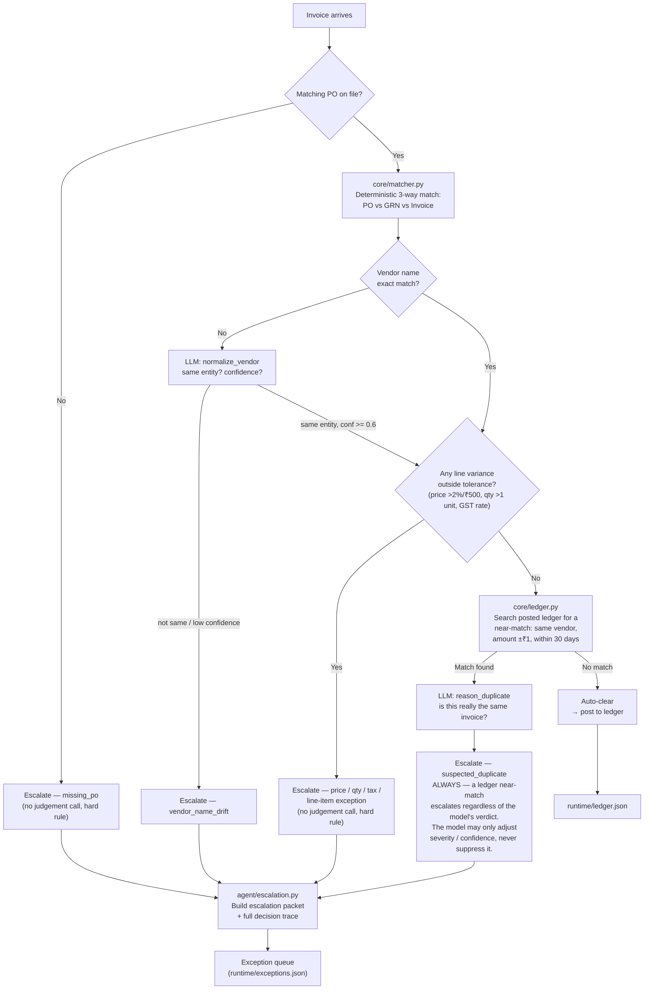
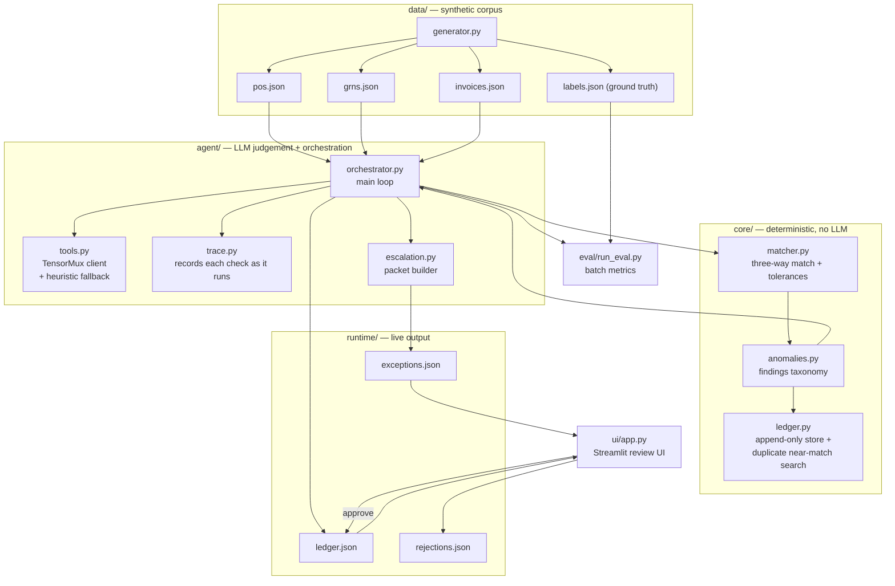

# Ledger Sentinel

An autonomous **accounts-payable three-way match** agent, built for **Syndicate by
Maximor**, Track 2 — Autonomous Office of the CFO.

Before a company pays a vendor invoice, an AP clerk has to manually reconcile three
documents: the **Purchase Order** (what we agreed to buy), the **Goods Receipt Note**
(what actually arrived), and the **Invoice** (what the vendor is billing us). If all
three agree, the invoice gets coded and posted to the ledger. If they don't, it goes
into an exception queue for a human to review.

Ledger Sentinel automates the clean path — and treats the exception path as the
actual product. It never guesses on an ambiguous invoice. It escalates with a
structured packet a human can act on in one click, and it shows its work: every
escalation carries an ordered trace of exactly what the agent checked, in what
order, before it decided to hand the invoice to a person.

**The core thesis:** a false-clear (auto-paying an invoice that should have been
escalated) costs far more than a false-escalate (sending a clean invoice to a
human needlessly). The agent is deliberately conservative — tuned to escalate when
uncertain, never to suppress a strong deterministic signal just because a
language model disagrees with it.

---

## Contents

- [How it works](#how-it-works)
- [The anomaly taxonomy](#the-anomaly-taxonomy)
- [Architecture](#architecture)
- [The escalation packet](#the-escalation-packet)
- [Review UI](#review-ui)
- [Design decisions worth knowing about](#design-decisions-worth-knowing-about)
- [Running it](#running-it)
- [Metrics](#metrics)
- [Known limitations](#known-limitations)

---

## How it works

Every invoice goes through the same pipeline: deterministic matching decides
**what's wrong**, and a language model is only ever consulted for genuine
judgement calls — is this vendor name the same legal entity, is this really a
duplicate, how should this be explained to a human. The model is never asked to
do arithmetic, and it is never allowed to be the *only* thing standing between
an invoice and getting paid twice.



That last branch — **suspected_duplicate always escalates, no matter what the
model says** — exists because of a real bug found during development. Early on,
escalation was gated on the model agreeing it was a duplicate; across repeated
300-invoice runs, the model occasionally answered "not a duplicate" for an
invoice that was, in fact, a re-submission of an already-posted one — which
would have paid it twice. The fix: a ledger near-match on vendor + amount + date
is sufficient **on its own** to route to a human. The model still runs and still
shapes the packet's summary, confidence and proposed resolution — it just can't
veto the escalation anymore.

---

## The anomaly taxonomy

The synthetic dataset (`data/generator.py`) seeds exactly these anomaly types,
proportionally, at any dataset size — 80% clean, 20% split across the taxonomy:

| Anomaly | What it looks like | Agent behaviour |
|---|---|---|
| Quantity variance | Invoice bills more than GRN received | Escalate |
| Price variance (in tolerance) | ≤2% or ≤₹500 total line impact over PO price | **Auto-clear** |
| Price variance (out of tolerance) | Meaningfully over PO price | Escalate, with the variance amount |
| Duplicate | Same vendor/amount/date, invoice number modified with a suffix | Escalate as suspected duplicate, linked to the original |
| Missing PO | No matching PO exists | Escalate for approver routing |
| Vendor name drift | "Acme Corp" vs "Acme Corporation Pvt Ltd" | **Resolve automatically** (LLM judgement) if confidently the same entity |
| Tax mismatch | Wrong GST rate applied | Escalate with the correct rate |
| Line-item mismatch | Invoice has a line not present on the PO | Escalate, isolating the offending line |

Two of these rows — in-tolerance price variance and vendor-name drift — are
supposed to auto-clear. The agent proving it doesn't panic on benign variance is
as important as it catching real problems; that's tracked directly in the
false-clear / auto-clear-rate metrics below.

---

## Architecture



`core/` never imports an LLM client and never sees a prompt. `agent/` never does
arithmetic — it consumes `core/`'s output and only ever answers judgement
questions. This split is itself load-bearing for auditability: a finance team
can point at any auto-clear or escalation and know exactly which parts were
computed and which parts were reasoned about.

---

## The escalation packet

Every escalation produces one JSON packet, designed to be read by a clerk in
under 10 seconds. This is a real packet from a real run — it's the invoice that
originally exposed the duplicate-veto bug described above, now correctly
escalating:

```json
{
  "invoice_id": "INV-4017-A",
  "vendor": "Bluewave Traders",
  "exception_type": "suspected_duplicate",
  "severity": "high",
  "confidence": 0.95,
  "summary": "Invoice INV-4017-A is a duplicate of INV-4017. The original invoice was already paid on Sept 6. The amounts and line items match exactly.",
  "proposed_resolution": "Reject as duplicate of INV-4017 (already paid).",
  "evidence": { "po": {...}, "grn": {...}, "invoice": {...}, "related": [...] },
  "requires": "ap_clerk_approval",
  "steps": [
    { "n": 1, "action": "retrieve_documents", "source": "deterministic",
      "detail": "Retrieved PO PO-2017 and GRN GRN-8017 for invoice INV-4017-A; 3 invoice line(s) to compare." },
    { "n": 2, "action": "three_way_match", "source": "deterministic",
      "detail": "PO, GRN and invoice agree on every line: quantities, unit prices and GST rates all match." },
    { "n": 3, "action": "vendor_check", "source": "deterministic",
      "detail": "Invoice vendor 'Bluewave Traders' matches the PO vendor exactly." },
    { "n": 4, "action": "ledger_duplicate_search", "source": "deterministic",
      "detail": "Searched posted ledger for Bluewave Traders invoices near Rs 734,733.60 within 30 days of 2026-07-26: found 1 candidate(s) -- INV-4017 (posted 2026-07-16)." },
    { "n": 5, "action": "judgement_duplicate", "source": "llm:glm-4-7-flash",
      "detail": "Duplicate assessment against 1 ledger candidate(s): duplicate at confidence 0.95 (threshold 0.50), related invoice INV-4017. ..." },
    { "n": 6, "action": "conclusion", "source": "llm:glm-4-7-flash",
      "detail": "Escalated as suspected duplicate (high severity, confidence 0.95). Proposed: Reject as duplicate of INV-4017 (already paid)." }
  ]
}
```

The `steps` array (`agent/trace.py`) is not a summary written after the fact —
each entry is appended by the orchestrator at the exact moment that check runs,
from that check's own real output. If a step says "searched the ledger, found no
near-matches," that search genuinely executed and genuinely found nothing.
Every step is tagged with its `source` (`deterministic`, `llm:<model>`, or
`heuristic-fallback`), so it's immediately visible how much of a decision was
arithmetic versus model judgement. Notice steps 1–4 here are all
`deterministic` — the model only enters at step 5, once there's an actual
judgement call to make.

---

## Review UI

`ui/app.py`, a single-page Streamlit app, dark-themed, meant to look like a tool
an AP clerk uses forty times a day rather than a demo:

- **Category filter tabs** — All / Quantity Variance / Suspected Duplicate / Line
  Item Mismatch, each showing a live count, filtering the already-loaded queue
  client-side (no new data, no new fetch).
- **Queue cards** — vendor, amount, exception type, a color-coded severity pill,
  and aging, in a bordered card that highlights on hover and gets an accent-color
  stripe when it's the item currently open in the detail pane.
- **Detail pane** — the plain-English summary and proposed resolution up top,
  the full reasoning trace in an expander below it, then the PO / Goods Receipt
  / Invoice shown as three side-by-side labeled cards with every mismatched
  field in red.
- **Approve / Reject** — one click each. Approve posts to the ledger; Reject logs
  to `runtime/rejections.json`. Either way the row disappears from the queue.

---

## Design decisions worth knowing about

A few choices that came out of actually running this against 300 invoices
rather than eyeballing the code, in case you're extending it:

- **Tolerance is evaluated on total monetary impact, not per-unit price.** A
  small per-unit price bump on a high-quantity line can still be a large rupee
  exposure; the matcher checks `qty × price_delta` against the ₹500 floor, not
  the raw unit delta. An earlier version checked the wrong number and let an
  18.8%-overpriced invoice slip through as "in tolerance."
- **A ledger near-match always escalates a suspected duplicate**, regardless of
  what the model concludes (see the flowchart above). The model can sharpen
  severity and confidence; it cannot suppress the escalation.
- **An invoice with a PO but no goods receipt still auto-clears** if price and
  tax match — quantity simply can't be verified against receiving in that case,
  and the trace says so explicitly rather than falsely claiming "quantities
  match." This is a known two-way-match gap, not a three-way match, for that
  specific case — see [Known limitations](#known-limitations).
- **Every LLM call has a deterministic fallback.** If `TENSORMUX_API_KEY` isn't
  set, `agent/tools.py` falls back to string-similarity heuristics instead of
  failing, so the whole pipeline (including `eval/run_eval.py`) still runs
  offline. Every judgement result carries `llm_used` so you can tell which path
  actually ran.

---

## Running it

```bash
pip install -r requirements.txt

# 1. Generate the synthetic dataset (any size; anomaly types stay proportional)
python data/generator.py --count 300 --out-dir data

# 2. Run the agent pipeline end to end
#    (set TENSORMUX_API_KEY in a .env file at the repo root to use real LLM
#     judgement; without it, the heuristic fallback runs instead)
python -m agent.orchestrator --data-dir data --out-dir runtime

# 3. Open the review UI
streamlit run ui/app.py

# 4. Batch-score against ground truth
python eval/run_eval.py --data-dir data --out-dir eval_out
```

`.streamlit/config.toml` carries the app's dark theme. `TENSORMUX_API_KEY` is
read from a `.env` file at the repo root if present (see `.gitignore` — this
file is intentionally never committed).

---

## Metrics

Run against the 300-invoice dataset (240 clean, 60 anomalies across the
taxonomy above), scored against `data/labels.json` ground truth:

| Metric | Result |
|---|---|
| Auto-clear rate | 86.67% (260 / 300) |
| **False-clear rate** | **0%** — the number a CFO actually cares about |
| Escalation precision | 100% — every escalation was a genuine anomaly |
| Escalations | 40 |

A false-clear (auto-paying something that should have been escalated) is the
one number this project is built around minimizing. See
[Design decisions](#design-decisions-worth-knowing-about) above for the one
place that number went wrong during development, and how it was fixed.

---

## Known limitations

Called out explicitly rather than left for someone to discover:

- **PO + no GRN auto-clears** if price/tax match, without quantity verification
  — a real two-way-match gap, since the generator never produces this case it
  isn't reflected in any metric above.
- **No OCR / real ERP integration** — invoices are structured synthetic JSON,
  by design (see the original spec's scope).
- **`cost_per_invoice_inr` reports 0** unless `TENSORMUX_PRICE_PER_1K_INR` is
  set — TensorMux's actual ₹/token pricing isn't hardcoded in.
- **No payment execution, auth, or multi-tenancy** — explicitly out of scope.
